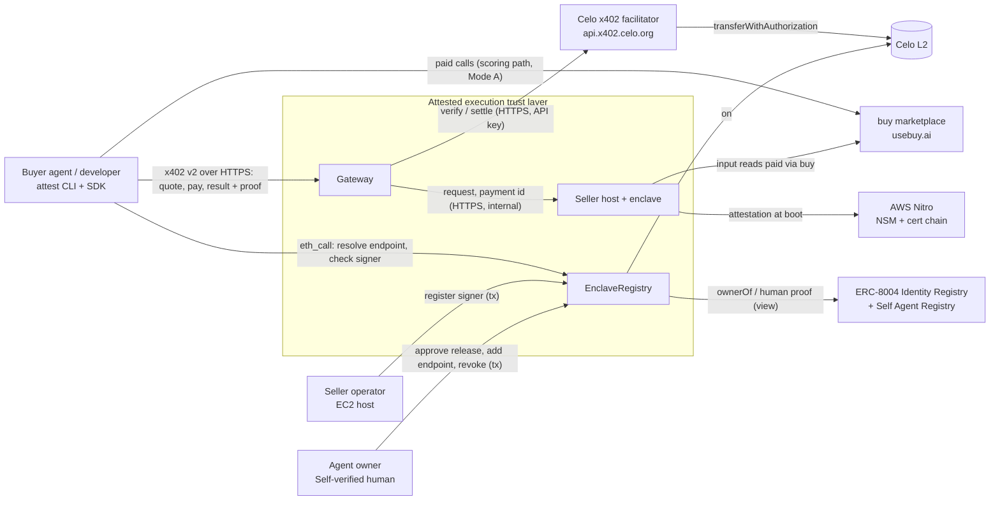
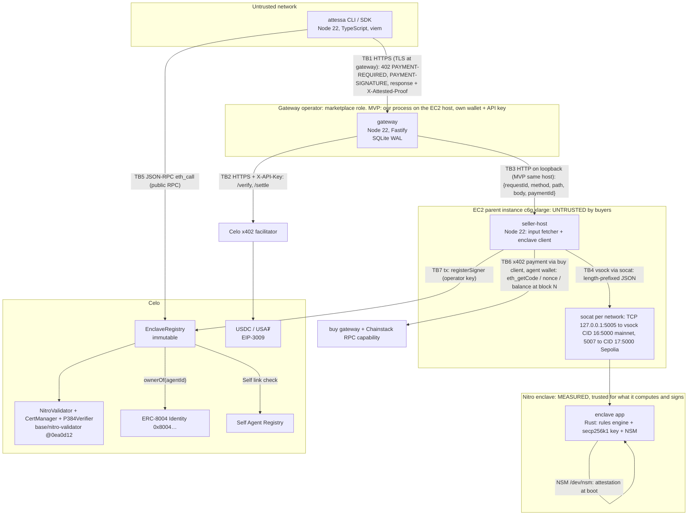

# ARCHITECTURE (r5)

Joshua, this is the architecture for the attested-execution trust layer on Celo. Facts and prices are from `RESEARCH.md` (checked 2026-10-19). Decisions are in `adr/`. The authoritative build spec is `SPEC.md`.

## 1. Solution strategy (the three ideas everything rests on)

1. **Verify once on chain, then check signatures off chain.**
   - An AWS Nitro attestation is expensive to verify on chain: ~13.8M gas warm, ~41.3M cold across 5 txs.
   - So it's verified **once per enclave boot**, and the result is a registered **signer** (an address) bound to an agent, an approved release and an endpoint.
   - Every paid response is then an EIP-712 signature by that signer. Buyers and gateways check it with one `eth_call` plus ECDSA recovery.
2. **The payment is only settled after the proof checks out, and the buyer re-checks independently.**
   - The gateway follows the x402 default `authorization` flow: verify payment → run → verify proof → settle → respond.
   - The buyer's SDK trusts neither the gateway nor the seller. It resolves the endpoint itself, refuses to sign unless `payTo` matches the registry, and re-verifies the proof.
   - Mode B protects against faulty or tampered output. Protection against a dishonest gateway comes from a short payment window, cancel, and independent evidence (ADR-006).
3. **The workload's inputs are public chain facts, so the operator can't quietly feed it lies.**
   - The demo seller is a payment-risk check. Its rules are published, and its inputs (account code, nonce, balance at a stated block) are read from Celo, paid for through buy.
   - The response carries the inputs (block, address, code, nonce, balance) and the proof commits to `inputsHash`. The gateway (always) and the SDK (when its RPC has the state) check the block is real and ≤ 300 s old and re-read code, nonce and balance at that block, so fabricated inputs are refused and anyone can audit them later. That narrows the main gap attestation leaves open ("the operator controls inputs") for this workload; block choice inside 300 s remains (L22). `attest audit` that does it for you is M1.

## 2. C4 level 1: context



## 3. C4 level 2: containers and trust boundaries



**What crosses each trust boundary**

| Boundary | Protocol | Auth | Data classification |
|---|---|---|---|
| TB1 buyer ↔ gateway | HTTPS (TLS 1.2+, cert for the registered origin) | x402 EIP-3009 signature per payment; EIP-191 payer signature for `/v1/results` | request body (buyer data, may be personal), payer address: confidential-in-transit |
| TB2 gateway ↔ facilitator | HTTPS | `X-API-Key` (settle) | payment payload: public once settled |
| TB3 gateway ↔ seller-host | HTTP on loopback (MVP); mTLS when split across hosts (M1) | none on loopback (same host, separate OS users) | request body, payment id |
| TB4 seller-host ↔ enclave | vsock (socat bridge) | none; the enclave trusts nothing from the parent except as input | request + inputs in, response + proof out |
| TB5 anyone ↔ registry reads | JSON-RPC | none | public |
| TB6 seller-host ↔ buy | x402 version selected by the buy capability | agent wallet EIP-3009 | public chain reads |
| TB7 operator/owner ↔ registry writes | Celo tx | ECDSA (operator / owner keys) | public |

**Where trust actually sits:**

- The enclave is trusted only for **what it computes over the bytes it's given and what it signs**.
- The parent, seller-host and gateway are untrusted by buyers. Everything they could tamper with is either covered by the proof or re-checked by the buyer:
  - request bytes → `requestHash`
  - response bytes → `responseHash`
  - payment → `paymentId`
  - inputs → `inputsHash`, re-readable on chain
- What they can still do is withhold, delay, reorder, or deny service.

## 4. On-chain / off-chain split

**Rule:** the chain holds only what a third party must be able to check without trusting us:

- who owns an agent
- which builds are approved
- which origin and payTo belong to which agent
- which keys came from a genuine enclave running an approved build, and their status

Everything per-request (proofs, settlement bookkeeping, results, evidence) stays off chain. It can be checked against chain state at any time.

| On chain | Off chain |
|---|---|
| Attestation verification (once per boot), signer registry, release and endpoint state, revocation, Self link | Proof signing and verification, liveness, x402 quote and settlement orchestration, result storage, evidence logs, input fetching |

## 5. Technology choices (pinned)

| Concern | Choice | Version / pin | Why (ADR) |
|---|---|---|---|
| Attestation verifier | base/nitro-validator (P384Verifier, CertManager, NitroValidator) | git commit `0ea0d12` (post-Cantina-audit fixes; no tags exist) | ADR-001 |
| Registry | Solidity, Foundry | solc: the exact version in nitro-validator's `foundry.toml` at that commit; the dependency's own settings (`optimizer_runs = 10000`, no `via_ir`; CertManager is 2,279 bytes under EIP-170 with them). T02 checks `forge build --sizes` | ADR-002 |
| Enclave app | Rust | `rust-toolchain.toml` pinned to the stable release current at T03 start; crates `aws-nitro-enclaves-nsm-api = 0.5.2`, `k256` (ECDSA secp256k1 + keccak via `sha3`) exact versions locked in `Cargo.lock` | ADR-007 |
| Enclave image | Docker → EIF via `nitro-cli build-enclave` (v1.5.2), reproducible via kaniko `--reproducible` + `SOURCE_DATE_EPOCH` | base image pinned by digest | ADR-008 (spike S3) |
| Gateway, seller-host, SDK, CLI | Node 22 LTS, TypeScript (strict), pnpm workspace, Fastify, viem ≥ 2.45, better-sqlite3 | exact versions in `pnpm-lock.yaml`; `.nvmrc` = 22 | ADR-011 |
| Payments | x402 v2 `exact` (EIP-3009), CAIP-2 networks `eip155:42220` / `eip155:11142220`, Celo hosted facilitator | `https://api.x402.celo.org`, `https://api.x402.sepolia.celo.org` | ADR-005 amendment r5 |
| Identity | ERC-8004 Identity Registry (reference deployment) + Self Agent ID link | mainnet `0x8004A169FB4a3325136EB29fA0ceB6D2e539a432`, Sepolia `0x8004A818BFB912233c491871b3d84c89A494BD9e` | ADR-009 |
| Attribution | `@celo/attribution-tags` `withAttribution(code)` on our own txs | code issued by Loops at enrollment | n/a |
| Host | AWS EC2 `c6g.xlarge` (4 vCPU, 8 GiB, arm64), allocator 3 vCPU / 3072 MiB; each enclave 1 vCPU / 1024 MiB (fixed in-enclave port 5000; CID 16 mainnet, 17 Sepolia, 18 test build on demand; host socat ports 5005/5007/5006), us-east-1 | ~$0.136/hr (third-party price, confirm) | ADR-008 |

## 6. Repository layout

```
/
├─ contracts/                 Foundry: EnclaveRegistry + scripts + tests
│  ├─ src/EnclaveRegistry.sol
│  ├─ src/interfaces/{IEnclaveRegistry,IIdentityRegistry,ISelfAgentRegistry}.sol
│  ├─ test/{unit,invariant,fork}/
│  ├─ script/{DeployValidatorStack,DeployRegistry,CacheCerts}.s.sol
│  └─ lib/nitro-validator (git submodule @0ea0d12)
├─ enclave/                   Rust enclave app + Dockerfile + build script
├─ packages/
│  ├─ core/                   shared: types, EIP-712 defs, hashing, origin normalisation, error codes
│  ├─ sdk/                    buyer + seller SDK (viem)
│  ├─ cli/                    `attessa` binary (alias `attest`)
│  ├─ gateway/                Fastify service
│  └─ seller-host/            input fetcher + enclave client + liveness relay
├─ vectors/                   cross-language test vectors (JSON): hashes, EIP-712 digests, origins, user_data
├─ docs/                      tutorial, how-tos, explanation, PRIVACY.md, TERMS.md
└─ (pack + harness files at root)
```

## 7. Capacity and cost

**Load (ASSUMPTION, demo-scale).**
- Up to 2,000 paid calls total over Oct 27–Nov 13. Peak 1 req/s during demos.
- End-to-end latency: input reads via buy ~1–2 s, enclave ~50 ms, settle ~2 s (1 s Celo blocks). That gives W ≈ 4 s.
- Little's Law: L = λ × W = 1 × 4 = **4 requests in flight**.
- The gateway runs a worker pool of 16, so 4× headroom. The enclave rules engine is CPU-trivial.

**Binding constraint per tier:**
- **Facilitator:** free credits (20 mainnet per live config, docs say 1) and its rate limit (429).
- **Input reads:** buy price per call (**ASSUMPTION** $0.001–0.01).
- **AWS instance hours.**
- Not binding: the chain, the registry (off the hot path), the enclave CPU.

**Saturation behaviour:**
- Gateway sheds with 503 `gateway_busy` above 16 in flight.
- Facilitator 429 → backoff (≤ 5 s, auto); 401/402 → `paused`: 503 `gateway_paused` before verify, quotes refused, the reconciler keeps resolving open rows.
- Rate limits are per IP and sized above the 1 req/s peak: unpaid evaluate 120/min, liveness 30/min (SPEC §6.1).

**On-chain gas** (Celo, ~200 gwei base fee on 2026-10-19, CELO ≈ $0.082):

| Action | Gas | CELO | USD |
|---|---|---|---|
| Deploy validator stack + registry | ASSUMPTION 15–25M | 3–5 | $0.25–0.41 |
| Cold signer registration (4 cert txs + 1 register) | 6.8 + 7.05 + 6.8 + 6.8 + ~14.0 = **41.45M** | 8.29 | $0.68 |
| Warm registration, same day (leaf cert + register) | 6.8 + ~14.0 = **20.8M** | 4.16 | $0.34 |
| Next-day registration (instance CA expired after 24 h: CA + leaf + register) | 6.8 + 6.8 + ~14.0 = **27.6M** | 5.52 | $0.45 |
| approveRelease / addEndpoint / revoke | ASSUMPTION ≤ 150k each | ≤ 0.03 | ≤ $0.003 |
| Settlement (paid by facilitator; fee recovered) | ASSUMPTION ~80k | 0.016 | $0.0013 |

Every tx stays under 16,777,216 gas, so it survives Karst (EIP-7825). The largest is ~14.0M.

**Run cost (hackathon window):**
- **AWS:** continuous availability Nov 2–13 (mainnet demo, outreach, judging) ≈ 264 h + ~60 h of development = 324 h × $0.136 = **$44.06** (credits). Billing alarm at **$50**.
- **Signer registrations and renewals:** two networks, a renewal every ≤ 4 days per network plus restarts: ~10 mainnet txs-groups × 5–7 CELO ≈ 60 CELO ≈ **$5**; Sepolia is free.
- **Input reads via buy:** one batched paid request per evaluate (four reads); if the capability can't batch, four paid calls per evaluate. Budget guard switches to Forno when buy spend exceeds settled revenue + 1 USDC.
- **Facilitator:** 20 free, then gas + 0.3%. At 0.02 USDC per call: 0.3% × $0.02 = $0.00006 + ~$0.0013 gas ≈ **$0.0014 per call**.
- **Input reads via buy:** ASSUMPTION $0.001–0.01 per paid request; per evaluate that is ×1 (batched) or ×4 (unbatched, which can exceed the $0.02 price; S7 decides).

**Per paid call:**
- cost ≈ $0.0014 (settle) + $0.001–0.01 (inputs) = **$0.0024–0.0114**
- revenue: $0.02, so positive margin at any assumed input price
- **Cost per active buyer per month** (ASSUMPTION 30 calls): $0.07–0.34

**At 1x, 10x, 100x:**

| Scale | Calls/day | First to break | Fix |
|---|---|---|---|
| 1x | 100 | Facilitator free credits | Prepay the facilitator balance |
| 10x | 1,000 | buy input cost / rate | Cache chain reads per (address, block) for 12 s (same block window) |
| 100x | 10,000 | Single enclave + single gateway | Second enclave behind the gateway; SQLite → Postgres; gateway runs at the marketplace (buy) |

## 8. Supporting documents

`THREAT-MODEL.md` (failure modes, STRIDE, risk register, actors/privileges). `PIPELINE.md`. `INVARIANTS.md`. `SPEC.md`.
