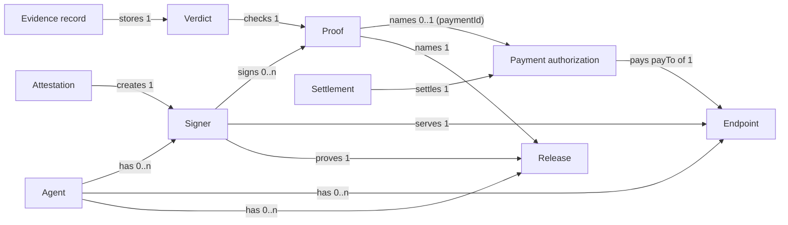
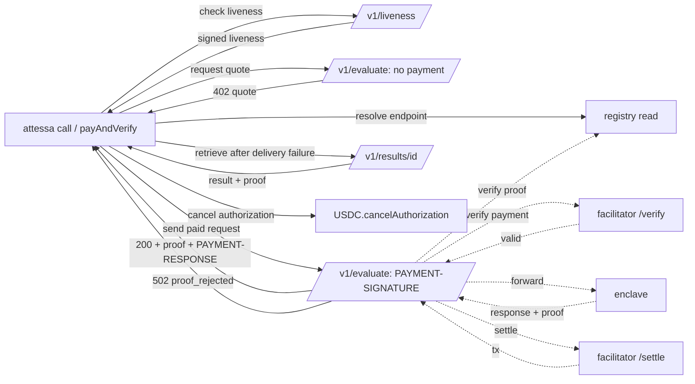
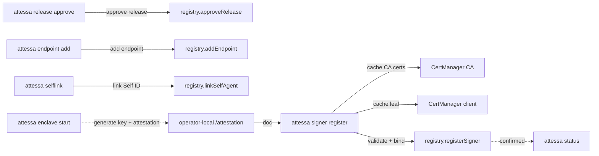
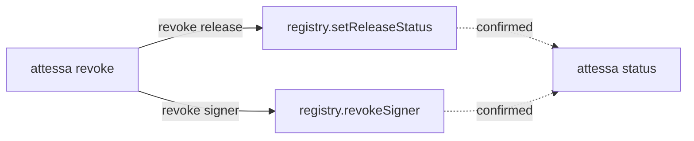
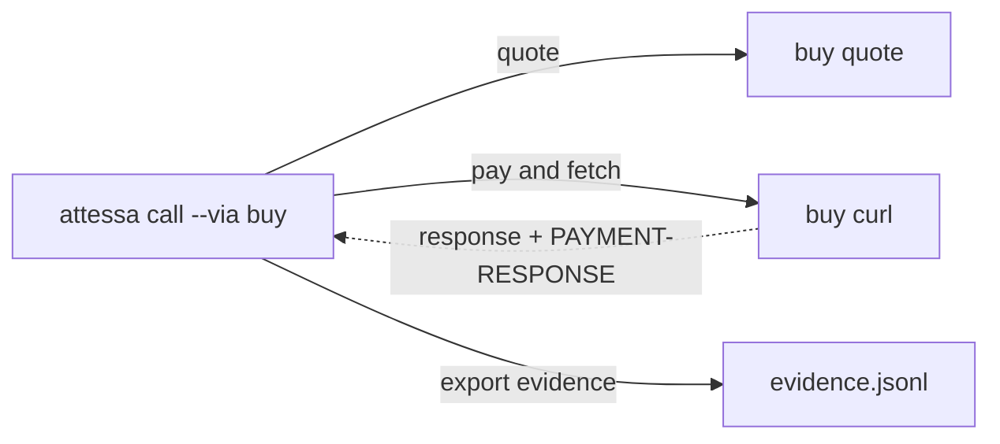
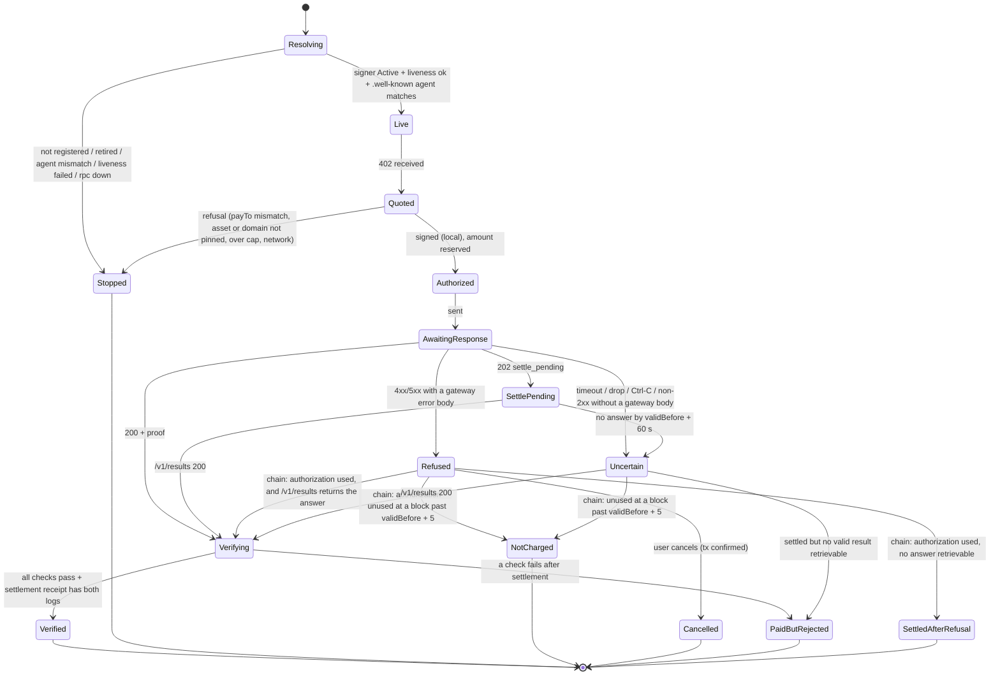
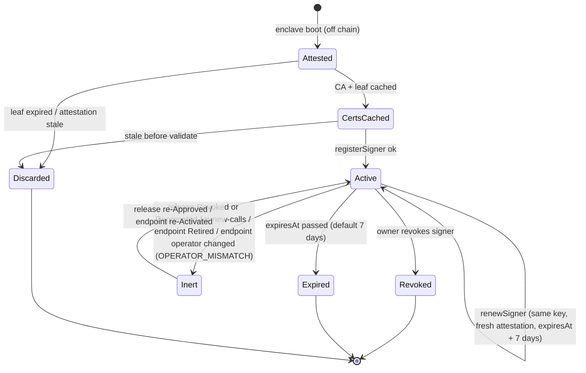

# Stage 2: flow design (r5)

> r5: x402 v2 is the production payment protocol on both Celo networks. A 400 or 412 from settlement is pending until chain evidence or expiry, never a final pre-expiry refusal. SPEC.md wins wherever this file disagrees.

Joshua, this is how the trust layer behaves, before any architecture. There's no UI in this product, so the "places" are what a person or agent actually touches: CLI commands, HTTP endpoints, SDK calls and contract functions. Facts cited here come from `RESEARCH.md` (checked 2026-10-19).

---

## 1. Frame

**Problem (premise line, used verbatim in the README).** You pay a service for an answer, it comes back wrong, and you can't tell whether the code the seller stands behind actually ran, or something else did. On buy (usebuy.ai, Celo's marketplace of pay-per-call APIs for agents) the money has already moved before the answer arrives.

**What it gives Ada**, honestly: it doesn't make the rules right. It tells her **whether the seller's approved rules ran**, so a bad answer is a rules problem she can read in the source, not an operator she can't see. And she only pays when that check passes.

**Who has it:**
- buyer agents and their developers
- buy, which resells 170 paid APIs under one payment address (`payTo`) and takes payment before calling the API

**What changes if it's solved.** A buyer (or buy, acting for buyers) pays only when the response carries a valid proof from an approved build, and otherwise keeps its money and records why.

**Appetite.** Three weeks to a mainnet demo (Nov 2), one more week of outreach and real usage, submission Nov 9. This is a constraint on the solution, not an estimate.

**No-gos:**
- proving model correctness or input truth
- refunds after settlement
- multiple TEE types
- KMS-sealed keys
- dashboards
- streaming responses
- request-body confidentiality from the gateway

### Context scenarios (no interface in them)

**Ada, a buyer agent's developer.** Ada's agent checks counterparties before paying invoices. It pays a third-party risk service per check. Last month a check came back "allow" for an address that drained a client. The provider swore its rules were fine; Ada had no way to know whether the published rules ran or someone edited them. What she wants: her agent pays for a check only if it can show the check came from the build the provider published. If it can't, her agent keeps the money and tells her which part failed.

**Tunde, a seller operator.** Tunde runs a paid evaluation service and wants buyers to trust it without trusting him. He'll publish the source, build it reproducibly, and run it somewhere he can't tamper with. He needs a short sequence: approve this build for my agent, start it, prove it's running, done. If he ships a broken build, he wants to pull it in one step and have buyers stop accepting it within a minute.

**Buy's gateway team.** They settle every payment before calling upstream, so when upstream fails or returns garbage, the buyer has paid. They'd like a step they can drop into their gateway: check the seller's proof first, settle only if it passes, and record the result as reputation.

**Joshua, demoing to judges.** He needs to show three outcomes in under two minutes: a paid call that verifies and settles, a tampered response that's refused and never charged, and a modified build that's refused.

---

## 2. Object model

### Objects

| Object | What it is, one line | Core content (defines an instance) | Metadata |
|---|---|---|---|
| **Agent** | an ERC-8004 identity that sells a service | `agentId` (ERC-721 token on the Identity Registry), owner address | registration file (services, `x402Support`, `supportedTrust`), linked Self Agent ID |
| **Release** | a build an agent's owner has approved to run | `releaseId` = keccak256(pcr0 ‖ pcr1 ‖ pcr2), the three PCR values | `sourceRef` (git commit URL), status Approved/Deprecated/Revoked, approvedAt, statusChangedAt |
| **Endpoint** | a public origin where an agent sells, and where its payments go | `origin` (scheme://host[:port]), `payTo` address, `operator` address | agentId, status Active/Retired |
| **Signer** | an enclave-generated key proven to run a release | signer address (from the 65-byte key in the attestation's `public_key`) | agentId, releaseId, origin, attestation hash, registeredAt, expiresAt, status Active/Revoked/Expired |
| **Attestation** | an AWS-signed document from the enclave | the COSE document (PCRs, `public_key`, `user_data`, timestamp, cert chain) | only its hash is stored on chain |
| **Quote** | an x402 v2 payment requirement for one call; one `accepts[]` entry per accepted asset (USDC, USA₮) | scheme `exact`, CAIP-2 network, amount, asset, payTo, resource, maxTimeoutSeconds | description, `extra` (token name/version, `assetTransferMethod:eip3009`, `paymentFlow:authorization`, `attestedExec` hint) |
| **Payment authorization** | the buyer's signed EIP-3009 transfer | from, to, value, validAfter, validBefore, nonce, signature | network, asset |
| **Request** | one input the buyer wants processed | `requestId` (32 random bytes, buyer-chosen), method, path, body | requestHash |
| **Proof** | the enclave's EIP-712 signature over what it produced | `{agentId, releaseId, requestId, requestHash, responseHash, inputsHash, paymentId, issuedAt, expiresAt}` + signature (SPEC §2.3 order) | signer address (recovered) |
| **Settlement** | the on-chain transfer that pays the gateway | tx hash, status | facilitator response, payer |
| **Verdict** | the result of checking a proof | outcome `verified` / `rejected(reason)` / `unattested` | checked-at block, which checks ran |
| **Evidence record** | the buyer's stored record of a call | requestId, verdict, settlement tx (if any), proof (if any), endpoint | local file; optionally posted as ERC-8004 reputation feedback |

Consolidated synonyms:
- "receipt" = **proof** (Cencori uses "receipt" for unsigned hashes; don't reuse the word)
- "runtime key" / "enclave key" = **signer**
- "service" / "seller URL" = **endpoint**
- "build" / "image" / "measurement" = **release**

### Nested object matrix (row → column)

| | Agent | Release | Endpoint | Signer | Proof | Payment auth | Settlement |
|---|---|---|---|---|---|---|---|
| **Agent** | n/a | has 0..n releases | has 0..n endpoints | has 0..n signers | is named in 0..n proofs | n/a | n/a |
| **Release** | belongs to 1 agent | n/a | n/a | runs under 0..n signers | is named in 0..n proofs | n/a | n/a |
| **Endpoint** | belongs to 1 agent | n/a | n/a | is served by 0..n signers | n/a | receives 0..n (its payTo) | receives 0..n |
| **Signer** | belongs to 1 agent | proves exactly 1 release | serves exactly 1 endpoint | n/a | signs 0..n proofs | n/a | n/a |
| **Proof** | names 1 agent | names 1 release | (via signer) 1 endpoint | signed by 1 signer | n/a | names 0..1 (paymentId) | n/a |
| **Payment auth** | n/a | n/a | pays 1 endpoint's payTo | n/a | is named by 0..1 proof | n/a | is settled by 0..1 |
| **Settlement** | n/a | n/a | credits 1 payTo | n/a | n/a | settles exactly 1 | n/a |

### Object graph



What the graph shows:
- **Signer** is the hub: it ties code (Release), place (Endpoint) and identity (Agent) together, so every check runs through it.
- **Attestation** has only an outgoing edge. It's evidence consumed once at registration and never referenced again except by hash.
- No orphans.

### CTA matrix by role

Roles:
- **Owner:** the human who holds the Agent NFT; optionally linked to a Self-verified identity (shown to buyers, never required).
- **Operator:** runs the EC2 host. May be the owner, but has its own wallet for gas.
- **Buyer:** a developer or an agent with spending bounds.
- **Gateway:** the marketplace/gateway operator; buy in production, us in the demo.
- **System:** registry contract, NitroValidator, facilitator, AWS NSM, Celo.
- **Anonymous:** anyone.

| Object | Owner | Operator | Buyer (agent) | Gateway | System | Anonymous |
|---|---|---|---|---|---|---|
| Agent | register (8004), link Self ID | n/a | read | read | n/a | read |
| Release | approve, deprecate, revoke | read | read | read | n/a | read |
| Endpoint | add (origin + payTo), retire | read | read, resolve by origin | read | n/a | read |
| Signer | revoke | **register** (permissionless given a valid attestation for an approved release + active endpoint) | read, check liveness | read | expire (by time) | read |
| Attestation | n/a | request (inside enclave at boot), submit | n/a | n/a | sign (AWS NSM) | n/a |
| Quote | n/a | set price (config) | request | issue | n/a | request |
| Payment auth | n/a | n/a | **sign** within bounds: per call ≤ `maxAmount` (e.g. 0.05 USDC), per day ≤ `dailyCap` (e.g. 2 USDC), validBefore ≤ 120 s; **cancel** | verify (facilitator `/verify`), settle only after a verified proof | settle (facilitator) | n/a |
| Request | n/a | n/a | send | forward to enclave | n/a | n/a |
| Proof | n/a | n/a | verify | verify | enclave signs | verify (pure function) |
| Settlement | n/a | n/a | read | trigger (facilitator `/settle`), reconcile, **export settlement log** (payer, payTo, asset, amount, tx, requestId, verdict) | execute | read |
| Evidence record | n/a | n/a | write, export, post as 8004 feedback (opt-in) | write own log | n/a | n/a |

**Bounds for non-human roles:**

- **Buyer agent:**
  - spends at most `maxAmount` per call and `dailyCap` per UTC day, in the quote's asset
  - never signs a quote whose `payTo` ≠ the endpoint's registered payTo
  - never signs with validBefore more than 120 s out
- **Gateway:**
  - may settle only an authorization whose proof verified, within validBefore, once
  - may not settle after a `rejected` verdict
- **System (registry):** accepts a signer only if:
  - the attestation timestamp is within 30 minutes of the block time and not in the future
  - none of PCR0, PCR1 or PCR2 is all zeros
  - `user_data` carries the exact binding (domain, chainId, registry, agentId, origin hash)

### Vocabulary

| Term | Means exactly | Never say |
|---|---|---|
| **attested** | carries a proof from a signer | "trusted", "secure" |
| **verified** | a buyer or gateway checked the proof against the registry and it passed | "proven correct" |
| **unattested** | no proof was offered (most services today) | "unverified" (that implies a failed check) |
| **rejected** | a proof was offered and failed a named check | "error" (a rejection is the product working) |
| **release** | an approved build, identified by its PCRs | "version" (the source tag is metadata) |
| **signer** | the enclave's key for one release at one endpoint | "wallet" |
| **endpoint** | origin + payTo, owned by an agent | "seller URL" |
| **proof** | the signed EIP-712 struct with a response | "receipt", "attestation" (the attestation is AWS's document) |
| **pay** (user copy) / **settle** (true term, shown muted) | move the buyer's money on chain | "charge", "pay out" |
| **sealed machine** (user copy) / **Nitro enclave** (true term) | an AWS machine whose running code is measured and that its operator can't log into or change | "secure hardware", "TEE" alone |
| **approved build** (user copy) / **release** (true term) | a build (PCR0–2) the agent owner approved. The commit is the owner's claim: copy says "owner says it's built from …" until someone reproduces it | "published code", "release" alone in buyer output |
| **cancel** | the buyer voids an unsettled authorization on chain | "refund" (nothing was taken) |
| **attested execution provenance** | the property: an approved build produced this response for this request | "trustless", "verifiable AI" |

Shared verbs across objects: **approve, revoke, register, resolve, verify, settle, cancel**.

---

## 3. Critical journeys

Tasks from the CTA matrix, scored frequency × reach × consequence (1–3 each; consequence doubled for money or irreversible acts):

| Task | Freq | Reach | Consequence (×2) | Score |
|---|---|---|---|---|
| Buyer pays-if-verified via gateway (Mode B) | 3 | 3 | 3×2 | **54** |
| Buyer refused and not charged (tamper / bad proof) | 2 | 3 | 3×2 | **36** |
| Operator brings a signer online (cold register) | 2 | 2 | 3×2 | **24** |
| Owner revokes a release or signer | 1 | 3 | 3×2 | **18** |
| Buyer pays a buy service and records attested/unattested (Mode A, the scoring path) | 3 | 2 | 2×2 | **24** |
| Owner approves a release + endpoint | 1 | 2 | 3×2 | 12 (folded into J3) |
| Gateway reconciles an uncertain settlement | 1 | 2 | 3×2 | 12 (folded into J1) |

Five critical journeys: J1 pay-if-verified, J2 refused-not-charged, J3 bring a signer online (includes approve), J4 revoke, J5 buy purchase with evidence.

### J1. Pay only if verified (Mode B)

- **User:** buyer agent, bounded by `maxAmount` and `dailyCap`.
- **Goal:** "get the answer and pay for it only if approved code produced it".
- **Tasks:**
  1. resolve endpoint → signer (registry read)
  2. liveness check (free)
  3. request → 402 quote
  4. check quote against bounds and registered payTo
  5. sign authorization
  6. send request + payment
  7. gateway verifies payment
  8. enclave executes and signs
  9. gateway verifies proof
  10. gateway settles
  11. response + proof + settlement returned
  12. buyer verifies independently
  13. evidence written
- **Instrumentation** (`flow_id` = requestId, events `j1.<step>`):
  - `resolved`, `liveness_ok`, `quoted`, `authorized`, `sent`, `payment_verified`, `executed`, `proof_verified`, `settle_submitted`, `settle_confirmed`, `delivered`, `buyer_verified`
  - Success = `buyer_verified`. Abandon timeout = validBefore + 30 s.
  - `settle_submitted` and `settle_confirmed` are separate steps.

### J2. Refused and not charged

- **User:** buyer agent.
- **Goal:** "if the answer isn't provably from approved code, keep my money and know why".
- **Tasks:**
  1. same as J1 up to `executed`
  2. gateway verification fails (bad signature, wrong requestId, hash mismatch, signer revoked, release not Approved)
  3. gateway does **not** settle; returns 502 `proof_rejected` + the failing check
  4. buyer SDK sees no settlement and, by default, waits out validBefore; optionally calls `cancelAuthorization`
  5. evidence written
- **Instrumentation:**
  - `j2.rejected{reason}`, `j2.not_settled`, `j2.cancel_submitted`, `j2.cancel_confirmed`, `j2.expired`
  - Success = authorization provably unspent: `authorizationState=false` after validBefore, or cancel confirmed.

### J3. Bring a signer online

- **User:** owner (once per release) then operator (each boot).
- **Goal:** "buyers can verify my running build without trusting me".
- **Tasks:**
  1. owner: approve release (PCR0-2 from the reproducible build output, sourceRef)
  2. owner: add endpoint (origin, payTo)
  3. operator: boot enclave
  4. enclave: generate key, request attestation with binding `user_data` and key in `public_key`
  5. operator: run `register`: cache CA certs (up to 4 txs, skipped when cached), then one validate+bind tx
  6. confirm the signer is Active
  7. smoke liveness
- **Instrumentation:**
  - `j3.release_approved`, `j3.endpoint_added`, `j3.enclave_booted`, `j3.attested`, `j3.cert_cached{n}`, `j3.signer_submitted`, `j3.signer_confirmed`, `j3.liveness_ok`
  - Abandon timeout: attestation timestamp + 30 min (registry window).

### J4. Revoke

- **User:** owner.
- **Goal:** "stop buyers accepting this build or key now".
- **Tasks:**
  1. `revoke release <id>` or `revoke signer <addr>`
  2. tx confirms
  3. gateways and SDKs reject on the next check, because they read status per call or via a ≤ 60 s cache
- **Instrumentation:** `j4.revoke_submitted`, `j4.revoke_confirmed`, `j4.first_rejection_after_revoke` (measures propagation).

### J5. Buy a buy service, with evidence (Mode A, scoring path)

- **User:** buyer agent on Joshua's agent wallet.
- **Goal:** "use real paid services and keep a verifiable record of what was attested".
- **Tasks:**
  1. `buy quote` via the wrapper
  2. pay through buy (settles before upstream)
  3. receive response
  4. look for a proof (header or inline envelope)
  5. verify if present, else mark `unattested`
  6. write evidence with the settlement tx
- **Instrumentation:**
  - `j5.quoted`, `j5.paid`, `j5.received`, `j5.verified|rejected|unattested`, `j5.evidence_written`
  - Payment protection is **none** here; the copy says so.

---

## 4. Breadboards

Places are underlined (`__name__`), affordances are listed under them, `→` is a connection, `⇢` is a system-initiated transition. Each affordance names its CTA cell.

### J1 + J2 (buyer and gateway)

```
__attest call__ (CLI) / payAndVerify() (SDK)        [Buyer × Request: send]
  resolve endpoint                    → __registry (read)__              [Buyer × Endpoint: resolve]
  check liveness                      → __POST /v1/liveness__         [Buyer × Signer: check liveness]
  request quote                       → __POST /v1/evaluate (no payment)__ [Buyer × Quote: request]
  sign authorization                  → (wallet, local)                  [Buyer × Payment auth: sign]
  send paid request                   → __POST /v1/evaluate (PAYMENT-SIGNATURE)__ [Buyer × Request: send]
  cancel authorization                → __USDC.cancelAuthorization__      [Buyer × Payment auth: cancel]

__POST /v1/evaluate__ (gateway)
  ⇢ verify payment                    → __facilitator /verify__           [Gateway × Payment auth: verify]
  ⇢ forward to enclave                → __enclave (vsock)__               [Gateway × Request: forward]
  ⇢ verify proof                      → __registry (read)__               [Gateway × Proof: verify]
  ⇢ settle                            → __facilitator /settle__           [Gateway × Settlement: trigger]
  ⇢ respond 200 / 402 / 502 / 504     → __attest call__

__GET /v1/results/{requestId}__ (gateway)                                  [Buyer × Request: send (retrieve)]
  retrieve delivered result           → __attest call__
```



### J3 (bring a signer online)

```
__attest init__ (CLI, anyone)                              [Buyer/Owner: set up wallet + network; local only]
  create or load wallet, choose network → (local keychain)
__attest agent register__ (CLI, owner)                     [Owner × Agent: register (8004)]
  register agent identity             → __IdentityRegistry.register__ (agentId read from `Registered` event)
__attest release approve__ (CLI, owner)                    [Owner × Release: approve]
  approve release (pcr0..2, sourceRef)  → __registry.approveRelease__
__attest endpoint add__ (CLI, owner)                       [Owner × Endpoint: add]
  add endpoint (origin, payTo)          → __registry.addEndpoint__
__attest selflink__ (CLI, owner, optional)            [Owner × Agent: link Self ID]
  link Self Agent ID                    → __registry.linkSelfAgent__
__attest enclave start__ (operator, on EC2; wraps nitro-cli run-enclave) [Operator × Attestation: request]
  ⇢ generate key, request attestation   → __/attestation (vsock, operator-local)__
__attest signer register__ (CLI, operator)                 [Operator × Signer: register]
  cache CA cert ×≤4                     → __CertManager.verifyCACertWithHints__
  cache leaf cert                       → __CertManager.verifyClientCertWithHints__
  validate + bind                       → __registry.registerSigner__
  ⇢ confirmed                           → __attest status__
__attest status__                                           [Anonymous × Signer: read]
```



### J4 (revoke)

```
__attest revoke__ (CLI, owner)
  revoke release <releaseId>   → __registry.setReleaseStatus(Revoked)__   [Owner × Release: revoke]
  revoke signer <address>      → __registry.revokeSigner__                [Owner × Signer: revoke]
  ⇢ confirmed                  → __attest status__
```



### J5 (buy purchase with evidence)

```
__attest call --via buy__ (CLI wrapper over `buy`)                      [Buyer × Payment auth: sign; Buyer × Proof: verify]
  quote                 → __buy quote__
  pay and fetch         → __buy curl --max-amount__
  ⇢ response            → verify proof if present, else mark unattested
  export evidence       → __evidence.jsonl__                  [Buyer × Evidence: export]
```



---

## 5. Affordance trace

States referenced are defined in section 7.

| # | Place | Affordance | Trigger | Precondition | What changes | Resulting state | On failure | Lands in |
|---|---|---|---|---|---|---|---|---|
| 1 | attessa call | resolve endpoint | command run | network reachable | none (read) | Call: Resolved | `endpoint_not_registered` / `endpoint_retired` / `origin_agent_mismatch` / `rpc_unavailable` → stop, nothing signed | attessa call |
| 2 | attessa call | check liveness | after resolve | an Active signer exists for the origin | none | Call: Live | `liveness_failed{reason}` → stop before quote | attessa call |
| 3 | attessa call | request quote | after liveness | n/a | none | Call: Quoted | `quote_unavailable` (not 402) / `quote_malformed` → stop | attessa call |
| 4 | attessa call | sign authorization | quote received | quote.payTo == registered payTo; asset and token domain equal the pinned ones; amount ≤ maxAmount; today's settled + reserved + amount ≤ dailyCap; network matches | local signature only (nothing on chain); amount reserved against the daily cap | Call: Authorized | refusal `payto_mismatch` / `over_max_amount` / `over_daily_cap` / `network_mismatch` → stop, nothing signed | attessa call |
| 5 | attessa call | send paid request | authorized | validBefore not passed | gateway receives auth | Call: AwaitingResponse | 202 → Call: SettlePending (poll #12); 4xx/5xx with a well-formed gateway body → Call: Refused (confirm on chain); any other non-2xx, timeout or drop → Call: Uncertain → reconcile (#9) | attessa call |
| 6 | /v1/evaluate | verify payment | PAYMENT-SIGNATURE received | selected `accepted` equals one offered v2 requirement | none | Gateway: PaymentVerified | 402 `payment_invalid{facilitatorReason}`; nothing executed | attessa call |
| 7 | /v1/evaluate | forward to enclave | payment verified | signer for this endpoint Active (cached ≤ 60 s) | enclave computes | Gateway: Executed | 504 `execution_timeout` (no settle); 503 `enclave_unavailable` (no settle) | attessa call |
| 8 | /v1/evaluate | verify proof and inputs block | executed | n/a | none | Gateway: ProofVerified | 502 `proof_rejected{check}` (incl. `stale_inputs`, `clock_skew`); no settle; result withheld | attessa call (J2) |
| 9 | /v1/evaluate | settle | proof verified; response persisted | validBefore − now ≥ 10 s | token moves buyer → payTo | Gateway: Settled | every ambiguous, 400, or 412 result → 202 `settle_pending` → reconcile (AuthorizationUsed + Transfer in one tx; expiry at a block past validBefore + 5) | attessa call |
| 10 | /v1/evaluate | respond | settled | n/a | result stored 24 h by requestId | Gateway: Delivered | connection drops → Gateway: DeliveryFailed; result retrievable via #12 | attessa call |
| 11 | attessa call | verify response (independent) | 200 received | proof header present | evidence written | Call: Verified | `proof_rejected{check}` **after payment** → evidence marked `paid_but_rejected` (gateway bug or collusion signal), alert | attessa call |
| 12 | /v1/results/{id} | retrieve | GET | requestId known; same payer (`X-Attest-Payer-Sig`) | none | Call: Verified (after #11) | 202 while settling; 404 `result_not_found` (never settled, or past 24 h) | attessa call |
| 13 | attessa cancel | cancel authorization | the cancel hint printed after a refusal (no prompt) | authorization not used | token `cancelAuthorization` tx (buyer pays CELO gas) | Call: Cancelled | `already_used` → reconcile: it was settled after all (gateway fault) → evidence `settled_after_refusal` | attessa call |
| 14 | attessa release approve | approve release | command | caller == ownerOf(agentId); PCRs non-zero, 48 bytes; sourceRef 1–256 bytes | release Approved | Release: Approved | `not_owner` / `invalid_pcr` / `invalid_source_ref` / `release_exists` | attessa status |
| 15 | attessa endpoint add | add endpoint | command | caller == owner; origin is https, lowercase, no path | endpoint Active | Endpoint: Active | `not_owner` / `invalid_origin` / `origin_taken` (bound to another agent) | attessa status |
| 16 | attessa selflink | link Self ID (optional) | command | caller owns both IDs (Self `linked` mode); human proof present and fresh | link stored | Agent: SelfLinked | `self_link_invalid` | attessa status |
| 17 | enclave boot | generate key + attest | process start | NSM available; not debug mode | key in enclave memory only | Signer: Attested (off chain) | `nsm_unavailable` / `debug_mode` → enclave exits | operator logs |
| 18 | attessa signer register | cache CA certs | command | doc's chain not expired | CertManager cache | Signer: CertsCached | `cert_expired` → `--fresh` (new report from the same machine, no restart); `gas_too_low` → retry with estimate | attessa signer register |
| 19 | attessa signer register | validate + bind | after certs | attestation ≤ 30 min old; release Approved; endpoint Active for this agent; `user_data` binding matches | signer Active | Signer: Active | `attestation_stale` → `--fresh` (no restart); `release_not_approved`; `binding_mismatch`; `debug_pcrs`; `endpoint_inactive` | attessa status |
| 20 | attessa revoke | revoke release | command | caller owner | release Revoked; all its signers fail checks | Release: Revoked | `not_owner` / `unknown_release` | attessa status |
| 21 | attessa revoke | revoke signer | command | caller owner | signer Revoked | Signer: Revoked | `not_owner` / `unknown_signer` | attessa status |
| 22 | attessa call --via buy | pay and fetch | command + confirm (or `--accept-unprotected`) | price ≤ per-call limit; buy CLI installed and funded | buy settles (before upstream) | Buy: Received | buy error passed through with its code; `upstream_failed_after_payment` noted in evidence | attessa call --via buy |
| 23 | attessa call --via buy | verify or mark unattested | response received | n/a | evidence row | Buy: Verified / Unattested / Rejected | `proof_rejected` → evidence + "stop buying from this service?" flag | attessa call --via buy |
| 24 | attessa call --via buy | export evidence | `--export` | evidence exists | file written | n/a | `nothing_to_export` | attessa call --via buy |
| 25 | attessa init | create or load wallet, choose network | command | none | key in OS keychain (or env/keystore used); config file with network + limits | Setup: Ready | `keychain_unavailable` → falls back to `--keystore` with a printed instruction | attessa init |
| 26 | attessa agent register | register agent identity | command + confirm | wallet funded with CELO | ERC-8004 identity NFT minted to this wallet | Agent: Registered | `insufficient_gas_funds` / `rpc_unavailable` | attessa status |
| 27 | attessa enclave start | start sealed machine and write attestation | command on EC2 | enclaves enabled on the instance; EIF built | enclave running; att.bin written | Signer: Attested | `nsm_unavailable` / `debug_mode` / `eif_missing` | attessa signer register |
| 28 | attessa cancel | void a pending payment permission | command | authorization unused, not expired | `cancelAuthorization` tx | Call: Cancelled | `already_used` → reconcile (#13) | attessa call |
| 29 | attessa call | resume instead of paying again | re-run with same origin + same input | a non-terminal pending ledger entry exists for (origin, requestHash) | none (reuses requestId) | previous Call state | n/a | attessa call |
| 30 | attessa enclave build | reproducible build of the service into an enclave image | command on EC2 in the repo at a clean commit | working tree clean; Docker/nitro-cli present | build/<name>.eif + build/measurements.json | Release: Built (local) | `dirty_tree` (uncommitted changes can't be published) / `build_failed{log}` | attessa release approve |

**The interactions nobody lists:**

| Interaction | What happens |
|---|---|
| **Re-run the same command (CLI "refresh")** | the SDK keeps a pending ledger keyed by (origin, hash of the input). Re-running with the same input while a call is still pending (not finished) resumes it ("Resuming it instead of paying again") via `/v1/results/{id}` or the chain check. It never pays twice for a call still in flight; `--new` forces a fresh call. Once a call has finished, re-running is a new paid call |
| **Ctrl-C mid-flow** | before signing: nothing happened. After signing, before response: the SDK writes the authorization to `pending.jsonl`, and the next `attessa status --pending` reconciles each item (settled, expired or cancel) |
| **Two concurrent calls (second tab)** | each has its own requestId and EIP-3009 nonce. `dailyCap` counts settled plus reserved amounts under a local file lock, so two processes can't both spend the last 0.10 USDC; a reservation is released only once the chain confirms it wasn't used |
| **Deep link / shared URL** | a buyer given only `https://seller.example` runs `attessa call https://seller.example`. The SDK fetches `/.well-known/attested-exec.json` for the agentId hint, then **verifies the hint against the registry** (origin must be registered to that agentId). The hint is never trusted |
| **Expired link** | a `requestId` older than 24 h → `result_not_found` with the settlement tx from local evidence, so the buyer can still prove payment |
| **Narrow viewport** | CLI output fits 80 columns; JSON mode (`--json`) for agents. No web UI exists |

---

## 6. Sample dialogs

Revised after the stage 2.5 UX gate. The pattern for every line:

1. the plain outcome first (did you pay, how much, what was checked)
2. the true term after it, in a muted bracket
3. hashes last

CLI output marks the muted parts with `(…)`. The SDK returns the same facts as fields.

### J0 first run (buyer), added by the UX gate

```
$ npm i -g @attessa/cli          # package name decided in stage 3
$ attessa init
→ attessa checks which build a service runs before you pay it, and only pays if the answer checks out.
→ Network: Celo Sepolia (test money). Use --network mainnet for real payments.
→ Wallet: none found. Created one for this computer: 0x51c2…9e (key stored in your OS keychain, never printed)
→ Fund it: CELO for gas at faucet.celo.org/celo-sepolia, test USDC at faucet.circle.com (choose Celo Sepolia)
→ Spending limits: at most 0.10 USDC per call and 1.00 USDC per day, unless you pass --max-amount / set --daily-cap.
→ Next: attessa call https://<service> --body input.json --max-amount 0.05
```

- **Existing key:** `ATTESSA_PRIVATE_KEY` in the environment or `--keystore <file>` is used instead of creating one. Wallet creation is never silent.
- **Network:** `--network sepolia|mainnet` is the primary flag. `--rpc` is an advanced override.
- **Default:** Sepolia until the user runs `attessa init --network mainnet`.

### J1 happy path

```
$ attessa call https://risk.example/v1/evaluate --body tx.json
→ Checking risk.example before paying
  Runs agent 412's approved build in a sealed machine the seller can't change  (release 0x9c4e…a1, Nitro enclave)
  Owner says it's built from github.com/acme/risk @ a1b2c3d  (not checked by attessa)
→ It's up and answering for this address right now  (liveness check, 0.4 s)
→ Price: 0.02 USDC (your limit per call: 0.10), paid to the address registered for this service.
  You sign a payment permission now (free). The service's gateway only uses it if the answer checks out, and it expires in 120 s either way  (EIP-3009 authorization)
→ Paid 0.02 USDC. The answer came from that approved build, for this request, using Celo data from block 31,204,118  (settled: tx 0xabc…, signer 0x7f3b…22)
→ Answer saved to result.json. Record: ~/.attessa/evidence.jsonl
```

Price above the limit:
```
→ Not paying: the price is 0.25 USDC and your limit per call is 0.10. Pass --max-amount 0.25 if that's fine. Nothing was signed.
```

### J2 tampered response

```
→ Price: 0.02 USDC … You sign a payment permission now (free).
→ Refused: the answer doesn't match what the sealed machine signed  (response hash differs from the proof)
→ Confirming you weren't charged: your payment permission expires unused at 14:02:11 UTC (in 94 s). Waiting…
  To void it right now instead: attessa cancel 0x5d1a…  (on-chain cancel, ~0.0004 CELO gas). Ctrl-C stops waiting; attessa status --pending checks later.
→ Not charged: confirmed on Celo, your payment permission expired unused  (block 31,204,245)
```

### J2 variant: the gateway took the money anyway

```
→ Warning: you were charged 0.02 USDC (tx 0xabc…) but the answer didn't check out  (paid_but_rejected)
  Payments made this way can't be reversed on chain. Only the gateway operator can send the money back.
  Your record (~/.attessa/evidence.jsonl, entry 0x5d1a…) proves the payment and the failed check.
  Report the gateway to the marketplace that listed it (for buy: github.com/celo-org/buy-skill/issues).
```

Refused, but the money moved anyway (`settled_after_refusal`):
```
→ Warning: the service refused this call, but your payment permission was used anyway: 0.02 USDC (tx 0xabc…). This is the gateway's fault.
  Your record (~/.attessa/evidence.jsonl, entry 0x5d1a…) proves the payment and the refusal. Report the gateway to the marketplace that listed it.
```

### J1 interrupted (timeout, dropped connection, Ctrl-C after signing)

```
→ Lost the connection after you signed. Checking whether you were charged…  (up to 2 minutes)
→ Not charged: confirmed on Celo, your payment permission expired unused at 14:02:11 UTC.
```
or
```
→ Charged 0.02 USDC (tx 0xabc…). Fetching your answer… done. It checks out.
```

Settlement still confirming (HTTP 202):
```
→ Payment sent, confirming (usually under 5 s; checking until 14:03:11 UTC)  (tx 0xabc…)
→ Paid 0.02 USDC. The answer came from that approved build, for this request …
```

Re-running the same command with the same input while a call is pending:
```
→ You already have a call in progress for this input (request 0x5d1a…). Resuming it instead of paying again.
```

### J3 bring a signer online (seller)

```
$ attessa seller --help
→ Sell an API that buyers can check before paying: you approve a build of your code, run it in a sealed AWS machine, and register that machine's key on Celo.
  Steps: agent register → enclave build → release approve → endpoint add → enclave start → signer register

$ attessa agent register --name "Acme risk check"
→ This creates your agent's public identity (ERC-8004) from this wallet. One transaction, about 0.05 CELO.  [register/cancel]
→ Registered: agent 412  (tx 0x…). Next: attessa enclave build.

# on the EC2 host, in your service's repo at the commit you'll publish
$ attessa enclave build
→ Built build/risk.eif from acme/risk @ a1b2c3d. Measurements written to build/measurements.json.  Next: attessa release approve.

$ attessa release approve --agent 412 --from-build build/measurements.json --source https://github.com/acme/risk/commit/a1b2c3d
→ Approving the build made from acme/risk @ a1b2c3d for agent 412  (release 0x9c4e…a1; PCR0-2 read from the build output)
  Buyers will see "owner says it's built from acme/risk @ a1b2c3d" (attessa can't check that claim). One transaction, about 0.03 CELO.  [approve/cancel]
→ Approved (tx 0x…). Next: attessa endpoint add.

$ attessa endpoint add --agent 412 --origin https://risk.example --pay-to 0xGATE…01
→ Buyers of risk.example will pay 0xGATE…01 and only accept answers from agent 412's approved builds. One transaction, about 0.03 CELO.  [add/cancel]
→ Added (tx 0x…).

# on the EC2 host
$ attessa enclave start --agent 412 --origin https://risk.example
→ Starting the sealed machine from build/risk.eif… running (Nitro enclave, 1 vCPU, 1 GiB)
→ It made a fresh signing key and AWS signed a report of what's running  (attestation written to att.bin; register within 30 minutes, or get a fresh one any time with --fresh)

$ attessa signer register --agent 412 --attestation att.bin
→ This publishes the machine's key on Celo so buyers can check it. Up to 5 transactions, about 8 CELO at today's price (3 of 4 certificates already cached, so 2 transactions, about 4 CELO).  [register/cancel]
→ [1/2] Certificate cached  (tx 0x…)
→ [2/2] Signer 0x7f3b…22 is live for risk.example, running agent 412's approved build  (tx 0x…)
→ Valid until Oct 26 14:00 UTC, or until the machine restarts. To renew without a restart: attessa signer renew. After a restart (new key): attessa enclave start, then attessa signer register (about 4–6 CELO, up to 8 if no certificates are cached).
→ Liveness check passed. Buyers can check this seller now.
```

Repair paths:
- **Stale attestation:** "Not registered: the machine's report is 41 minutes old and Celo accepts 30. Run `attessa signer register --fresh` to get a new report from the same machine (no restart)."
- **Wrong build:** "Not registered: this machine runs a build agent 412 hasn't approved (release 0x11ab…). Approve it with `attessa release approve`, or start the approved build."
- **Debug mode:** "Not registered: the machine was started in debug mode, which AWS doesn't sign for. Start it without --debug-mode."

### J4 revoke

```
$ attessa revoke release 0x9c4e…a1
→ This stops buyers paying for answers from this build (owner says acme/risk @ a1b2c3d). Its 1 live signer stops working within 60 s, and risk.example refuses calls until you approve and register another build. Revoking is permanent.  [revoke/cancel]
→ Revoked (tx 0x…).
```

### J5 a buy purchase, with a record (renamed `attessa call --via buy`)

```
$ attessa call --via buy https://<buy-capability>
→ Price: 0.005 USDC. buy (usebuy.ai, Celo's pay-per-call API marketplace) takes payment before the service runs, so this call isn't protected by the check: you pay even if the answer fails it.  [pay/cancel]   (--accept-unprotected skips this prompt for agents)
→ Paid 0.005 USDC through buy (tx 0x…)
→ No proof offered: this service doesn't say which code produced its answer, so it can't be checked  (unattested)
  Answer saved. Record: ~/.attessa/evidence.jsonl
```

---

## 7. State inventory

### Call (buyer SDK/CLI): more than three states, statechart



`Refused` is not `NotCharged`. The CLI says "Not charged" only from the chain (SPEC §7, INV-20). The reservation is released on `NotCharged`/`Cancelled` and becomes spend on every settled end state.

Parallel axes:
- **Network:** RPC reachable / unreachable.
- **Wallet:** has funds / insufficient. Insufficient funds is caught by facilitator `/verify` → `payment_invalid{insufficient_funds}`.
- **Pending ledger:** an item exists or not.

Every state above has an exit. `Refused`, `SettlePending` and `Uncertain` resolve from chain state, never by guessing.

### Gateway request: more than three states, statechart (SPEC §6.2 r5)

```mermaid
stateDiagram-v2
  [*] --> Received
  Received --> Paused503: paused (no verify, no execution)
  Received --> BadRequest400: body fails §4.3
  Received --> Quoted402: no PAYMENT-SIGNATURE
  Received --> PaymentChecking: PAYMENT-SIGNATURE present
  PaymentChecking --> Existing: requestId or nonce already has a row (idempotency table)
  PaymentChecking --> PaymentInvalid: facilitator isValid=false (no row written)
  PaymentChecking --> PaymentVerified: valid (row inserted)
  PaymentVerified --> Executing: signer pre-check OK
  PaymentVerified --> ExecFailed: signer not OK
  Executing --> ExecFailed: timeout / unavailable / bad_request / bad_inputs
  Executing --> ProofChecking: response + proof
  ProofChecking --> ProofRejected: any check fails (incl. inputs block)
  ProofChecking --> TooLate: validBefore - now < 10 s
  ProofChecking --> Settling: all checks pass; response persisted
  Settling --> Settled: success
  Settling --> SettlePending: 400/412, ambiguous, 5xx, timeout, or 401-402 (also pauses)
  SettlePending --> Settled: AuthorizationUsed + Transfer(payer to payTo) in one tx
  SettlePending --> SettleFailed: used elsewhere / cancelled / unused at a block past validBefore + 5
  Settled --> Delivered: response written
  Settled --> DeliveryFailed: client gone, or no live response after 30 s
  Executing --> ExecFailed: startup sweep after a crash
  PaymentVerified --> ExecFailed: startup sweep after a crash
  Paused503 --> [*]
  BadRequest400 --> [*]
  Quoted402 --> [*]
  Existing --> [*]
  PaymentInvalid --> [*]
  ExecFailed --> [*]
  ProofRejected --> [*]
  TooLate --> [*]
  SettleFailed --> [*]
  Delivered --> [*]
  DeliveryFailed --> [*]
```



Invariants:
- `Settling` is entered at most once per payment nonce. The gateway persists the response, proof and state **before** calling `/settle`.
- `ProofRejected`, `ExecFailed`, `PaymentInvalid` and `TooLate` never call `/settle`.
- `/v1/results` serves `Settled`, `Delivered` and `DeliveryFailed` rows (with the payer's signature), and 202 for `Settling`/`SettlePending`.

### Signer (on chain): statechart



- `Inert` is derived (not stored): the signer is fine, but its release or endpoint isn't. Checks evaluate signer AND release AND endpoint.
- **Revocation is terminal.** A revoked signer can't come back; the operator registers a new key.

### Release (on chain)

Four states (Approved, Deprecated, Revoked, plus nonexistent). Approved → Deprecated → Revoked, and Approved → Revoked.

| Status | New calls | Historical proofs |
|---|---|---|
| Approved | accepted | valid |
| Deprecated | refused | still "approved at execution time" |
| Revoked | refused | flagged "revoked after"; the consumer decides |

Status changes are only made by the owner.

### Endpoint

Active / Retired. Origin is unique across all agents: an origin bound to agent A can't be added to agent B until A retires it.

### Permission axis (every place)

| Role | Contract writes | Reads | HTTP |
|---|---|---|---|
| Owner | allowed | open | n/a |
| Non-owner on owner-only functions | `not_owner` | open | n/a |
| Operator | `registerSigner` only, gated by attestation validity | open | n/a |
| Anonymous | none | open | liveness and quotes, rate-limited per IP (liveness 30/min, unpaid evaluate 120/min; SPEC §6.1) |

Wrong network:
- The CLI reads `chainId` from the RPC and refuses on mismatch with the configured registry.
- A quote whose network ≠ configured → `network_mismatch`.

---

## 8. Copy and errors

### Places

| Place | Heading line | Primary CTA (= affordance) | Secondary | Helper | Empty | Success |
|---|---|---|---|---|---|---|
| attessa call | "Calling {origin}" | send paid request | `--dry-run` (stops before signing), `--json` | "Nothing is paid until the response's proof checks out." | n/a | "Verified … Settled …" |
| attessa call --via buy | "Buying through buy" | pay and fetch | `--export` | "buy settles before the service runs. This payment isn't protected; the proof check only tells you what you got." | "No purchases yet. Try `attessa call --via buy <url> --max-amount 0.01`." | "Verified" / "Unattested" (both are success states) |
| attessa signer register | "Registering signer for agent {id}" | validate + bind | `--dry-run` (estimates gas) | "Up to 5 transactions; cached certificates are skipped." | n/a | "Signer {addr} registered … Buyers can verify this signer now." |
| attessa release approve | "Approving release for agent {id}" | approve release | n/a | "Approve only builds you can reproduce from {sourceRef}." | n/a | "Release {id} approved." |
| attessa revoke | "Revoking" | revoke release / revoke signer | n/a | "Takes effect within 60 s for gateways and SDKs." | n/a | "Revoked." |
| attessa status | "Agent {id}" | n/a | `--pending` | n/a | "No releases yet. Approve one with `attessa release approve`." | lists releases, endpoints, signers with states |

### Errors and refusals

Refusals (the product working) are marked **R**.

**`{tail}` rule (r2).** A gateway can only say what it did, not what the chain did. So:
- if nothing was signed yet: `{tail}` = "Nothing was signed."
- if a payment permission was signed: `{tail}` = "Your payment permission wasn't used." and the CLI then prints the "refused, confirming" line, ending in "not charged (confirmed)" or "settled after refusal".
- HTTP bodies from the gateway always use the second form on paid requests and the first on unpaid ones.
- A non-2xx with no well-formed gateway body (a proxy error page, a dropped connection) is not a refusal: the CLI shows the "interrupted after signing" lines and checks the chain, then fetches the answer if the payment went through.

| Trigger | What happened | Why (if actionable) | The one next action | Container | Machine code + suggestion |
|---|---|---|---|---|---|
| endpoint not in registry | "{origin} isn't registered as an attested endpoint." | n/a | "Pay it without protection using `attessa call --via buy`, or ask the seller to register." | CLI line / SDK error | `endpoint_not_registered` → `resolve_by_agent_id` |
| R: payTo mismatch | "Not paying: this service asked to be paid at {x}, but its registered payment address is {y}. It may be an impostor." | possible impostor | "Don't retry. Report it to where you found the link (for buy: github.com/celo-org/buy-skill/issues)." | CLI line | `payto_mismatch` → `report_endpoint` |
| R: over max amount | "Not paying: the price is {p} USDC and your max is {m}." | n/a | "Raise `--max-amount` if that's fine." | CLI line | `over_max_amount` → `increase_max_amount` |
| R: over daily cap | "Not paying: this would take today's spend to {s} USDC; your cap is {c}." | n/a | "Wait until 00:00 UTC or raise `--daily-cap`." | CLI line | `over_daily_cap` → `wait_or_raise_cap` |
| liveness failed | "Not paying: the sealed machine for {origin} didn't answer a fresh check, so it may be down or this may not be the real address  (liveness)." | n/a | "`attessa status {origin}` shows when it last answered." | CLI line | `liveness_failed{reason}` → `retry_later` |
| payment invalid | "Not paid: the payment permission was refused because {plain facilitator reason}." | e.g. "your wallet has 0.01 USDC and the price is 0.02" | "Add at least {n} USDC to {address}." | HTTP 402 body | `payment_invalid{insufficient_funds\|...}` → per reason |
| R: proof rejected (Mode B) | "Refused: {check in words}. {tail}" | names the failed check | "The CLI confirms on Celo once your permission expires ({t} s); or cancel it now." | HTTP 502 body + CLI | `proof_rejected{bad_signature\|request_mismatch\|response_hash_mismatch\|payment_mismatch\|inputs_hash_mismatch\|inputs_mismatch\|stale_inputs\|clock_skew\|signer_not_active\|release_not_approved\|endpoint_mismatch\|agent_mismatch\|operator_mismatch\|proof_expired}` → `wait_or_cancel` |
| execution timeout | "The service didn't respond in 20 s. {tail}" | n/a | "Retry with a new request." | HTTP 504 | `execution_timeout` → `retry_new_request` |
| enclave unavailable | "The service is offline. {tail}" | n/a | "`attessa status {origin}` shows when it was last up." | HTTP 503 | `enclave_unavailable` → `retry_later` |
| R: too late to settle | "Not settled: your payment permission expires in under 10 s, too close to settle safely. {tail}" | n/a | "Retry; the SDK uses a fresh 120 s window." | HTTP 502 | `authorization_expiring` → `retry_new_request` |
| settle pending | "Payment sent, confirming (usually under 5 s; checking until {validBefore} UTC)  (tx {h})." | n/a | (automatic; no action) | CLI progress | `settle_pending{tx}` → `poll_results` |
| settle failed | "Payment didn't go through: {reason}. The result was withheld. {tail}" | after reconciliation proved cancellation, expiry, or another use of the nonce | "Retry with a new request." | HTTP 502 on an idempotent repeat | `settle_failed{reason}` → `retry_new_request` |
| paid but rejected | "Warning: you were charged {p} USDC but the answer didn't check out: {check}. On-chain payments can't be reversed; only the gateway operator can send it back." | gateway fault | "Report the gateway to the marketplace that listed it, with record {requestId} from ~/.attessa/evidence.jsonl." | CLI warning | `paid_but_rejected` → `report_gateway` |
| result not found | "No stored result for request {id}." | expired after 24 h, or never settled | "Check `attessa status --pending`." | HTTP 404 | `result_not_found` → `check_pending` |
| R: attestation stale | "Not registered: the attestation is {n} minutes old; the registry accepts 30." | n/a | "Run `attessa signer register --fresh` (same machine, no restart)." | CLI | `attestation_stale` → `reattest` |
| R: release not approved | "Not registered: release {id} isn't approved for agent {a}." | n/a | "Approve it or run the approved build." | CLI | `release_not_approved` → `approve_release` |
| R: debug PCRs | "Not registered: the enclave is in debug mode." | n/a | "Restart without --debug-mode." | CLI | `debug_pcrs` → `restart_enclave` |
| R: binding mismatch | "Not registered: the attestation was made for {other agent/chain/origin}." | n/a | "Re-attest with the right agent and origin in the config." | CLI | `binding_mismatch{field}` → `reattest` |
| cert expired | "The certificate chain in this attestation has expired." | leaf certs live ~3 h | "Run `attessa signer register --fresh` (a fresh report carries current certificates)." | CLI | `cert_expired` → `reattest` |
| R: not owner | "Only agent {a}'s owner ({o}) can do this; this command was signed by {s}." | n/a | "Run it from the owner wallet (--keystore or ATTESSA_PRIVATE_KEY)." | CLI | `not_owner` → `use_owner_wallet` |
| R: origin taken | "{origin} is already registered to agent {b}." | n/a | "Use a different origin or ask agent {b}'s owner to retire it." | CLI | `origin_taken` → `choose_origin` |
| wrong network | "Your RPC is on chain {x}; this registry is on {y}." | n/a | "Set `--rpc` for {y}." | CLI | `network_mismatch` → `set_rpc` |
| rpc unavailable | "Can't reach Celo at {rpc}. Nothing was signed." | n/a | "Retry or set another `--rpc`." | CLI | `rpc_unavailable` → `retry_or_set_rpc` |
| no spending limit configured | "No per-call limit is set, so nothing was signed." | n/a | "Run `attessa init` or pass --max-amount in USDC (for example --max-amount 0.05)." | CLI | `max_amount_required` → `run_init` |
| no wallet | "No wallet set up yet." | n/a | "Run `attessa init`." | CLI | `no_wallet` → `run_init` |
| endpoint retired | "{origin} has stopped selling (its owner retired it). Nothing was signed." | n/a | "`attessa status --agent {a}` lists its current endpoints." | CLI | `endpoint_retired` → `list_endpoints` |
| quote unavailable | "{origin} didn't ask for payment the expected way (got HTTP {code}). Nothing was signed." | n/a | "Check the URL; `attessa status {origin}` shows the registered path." | CLI | `quote_unavailable` → `check_url` |
| quote malformed | "{origin} asked for payment in a form this version can't read. Nothing was signed." | n/a | "Update with `npm i -g @attessa/cli`." | CLI | `quote_malformed` → `update_cli` |
| interrupted after signing | "Lost the connection after you signed. Checking whether you were charged (up to 2 minutes)." | n/a | (automatic; resolves to charged or not charged) | CLI progress | `uncertain` → `reconcile` |
| cancel: already used | "Too late to cancel: the payment went through (tx {h}). Fetching your answer." | n/a | (automatic) | CLI | `already_used` → `get_result` |
| settled after refusal | "Warning: the service refused this call, but your payment permission was used anyway (tx {h})." | gateway fault | same as paid but rejected | CLI warning | `settled_after_refusal` → `report_gateway` |
| upstream failed after payment (via buy) | "buy took the payment (tx {h}) but the service didn't answer." | buy pays before calling | "buy has no refunds. Your record has the tx if you contact buy." | CLI | `upstream_failed_after_payment` → `contact_marketplace` |
| nothing to export | "No calls recorded yet, so there's nothing to export." | n/a | "Make one with `attessa call`." | CLI | `nothing_to_export` → `make_call` |
| R: invalid origin | "Use just the scheme and host, like https://risk.example (no path, lowercase)." | n/a | (the example is the action) | CLI | `invalid_origin` → `fix_origin` |
| R: invalid build file | "Couldn't read the build measurements in {file}. It should be the JSON that `nitro-cli build-enclave` prints." | n/a | "Pass the file nitro-cli wrote." | CLI | `invalid_pcr` → `use_build_output` |
| R: release exists | "This build is already approved for agent {a} (release {id})." | n/a | (nothing to do; `attessa status` shows it) | CLI | `release_exists` → `none` |
| R: Self link invalid | "Can't link Self Agent ID {sid}: it must be held by this wallet (Self's linked mode) and have a current human proof." | n/a | "Check it in the Self app, then run `attessa selflink` again." | CLI | `self_link_invalid` → `verify_with_self` |
| gas too low | "The transaction ran out of gas at {step}. Nothing changed." | n/a | "Run again; the CLI re-estimates." | CLI | `gas_too_low` → `retry` |
| R: endpoint inactive | "Not registered: {origin} isn't an active endpoint for agent {a}." | n/a | "Add it with `attessa endpoint add`." | CLI | `endpoint_inactive` → `add_endpoint` |
| unknown release / signer | "Agent {a} has no release (or signer) {id}." | n/a | "`attessa status --agent {a}` lists them." | CLI | `unknown_release` / `unknown_signer` → `status` |
| enclave can't attest | "The sealed machine couldn't get a signed report from AWS (no /dev/nsm). Is this a Nitro-enabled instance?" | n/a | "Use an instance type with enclaves enabled, like c6g.xlarge with --enclave-options Enabled=true." | operator log | `nsm_unavailable` → `enable_enclaves` |
| gateway paused | "The service can't take payments right now. {tail}" | n/a | "`attessa status {origin}`." | HTTP 503 | `gateway_paused` → `retry_later` |
| interrupted, payment found | "The payment went through (tx {h}). Fetching your answer…" | n/a | (automatic: ends verified, or the paid-but-rejected warning) | CLI progress | `uncertain` → `get_result` |
| R: renew refused | "Not renewed: {reason in words}." | e.g. "the signer already expired", "this report is from a different key" | expired: "Restart with `attessa enclave start`, then `attessa signer register`." Otherwise: "Run `attessa signer renew` on the machine that holds this key." | CLI | `signer_not_active` / `signer_mismatch` / `release_mismatch` → `register_new_signer` / `renew_on_host` |
| refused, confirming | "Confirming you weren't charged: your payment permission expires unused at {t} UTC (in {n} s). Waiting…" | n/a | "Ctrl-C stops waiting; `attessa cancel {id}` voids it now." | CLI progress | `refused` → `confirm_not_charged` |
| not charged (confirmed) | "Not charged: confirmed on Celo, your payment permission expired unused  (block {b})." | n/a | (none: done) | CLI success | `not_charged` |
| origin agent mismatch | "Not paying: {origin} says it's agent {x}, but the registry has it as agent {y}. Nothing was signed." | possible impostor or misconfiguration | "Don't retry. Report it to where you found the link." | CLI | `origin_agent_mismatch` → `report_endpoint` |
| bad request | "The service can't read this input: {detail}. {tail}" | e.g. "addresses must be lowercase hex" | "Fix the input and call again." | HTTP 400 | `bad_request` → `fix_request` |
| window too short | "Your payment permission expires too soon for this service (under 40 s left). {tail}" | usually a slow clock or network | "Call again; the SDK signs a fresh 120 s window from Celo's clock." | HTTP 402 | `authorization_window_too_short` → `retry_new_request` |
| request already used | "This request id or payment permission was already used for a different call. {tail}" | n/a | "Call again with `--new`." | HTTP 409 | `payment_reused` / `request_id_conflict` → `retry_new_request` |
| in progress | "This call is already running. Checking again in 2 s." | n/a | (automatic) | HTTP 409 | `in_progress` → `retry_same_request` |
| busy / rate limited | "The service is busy. Nothing was signed." | n/a | "Try again in {n} s." | HTTP 503 / 429 | `gateway_busy` / `rate_limited` → `retry_later` |
| R: operator mismatch | "Not registered: {address} isn't the operator for {origin}." | n/a | "Run from the operator wallet set in `attessa endpoint add`." | CLI | `not_operator` → `use_operator_wallet` |

---

## 9. Heuristic review

| Heuristic | Result |
|---|---|
| Status visible | Every async state has a CLI line or HTTP status; `settle_pending` shows the tx hash. No silent waits |
| User's vocabulary | Steps use release / signer / endpoint / proof / settle / cancel, never PCR/COSE in primary copy (PCRs appear only in `release approve` input) |
| Control | Every call can stop before signing (`--dry-run`); Ctrl-C after signing is recovered by `status --pending` |
| Consistency | "Verified", "Refused", "Unattested", "Settled", "Not charged" mean the same everywhere. "Not charged" is never shown before the chain confirms it |
| Prevention over handling | Three branches deleted upstream: (1) payTo binding deletes the spoofed-seller branch before any signature; (2) the requestId-replay branch is handled by serving the stored result, never settling twice; (3) the on-chain challenge nonce is deleted by using the NSM-signed timestamp window + `user_data` binding (see FRAME §6 and the stage-3 ADR) |
| Recognition over recall | `attessa status` shows agent, releases, endpoints, signers and pending items; nothing needs remembering from a prior command |
| Minimalism | Self linking is optional; cert caching steps are skipped when cached; `attessa signer renew` renews without a restart |
| Recovery | Every error row has one next action |
| Undo over confirm | Confirms only where there is no undo and money or service is at stake: `agent register`, `release approve`, `signer register` (shows CELO cost), `revoke` (permanent, takes the service offline), and `call --via buy` (unprotected payment). Each prompt names the consequence and uses the verb as the button. `--yes` / `--accept-unprotected` for non-interactive agents. Cancel no longer prompts: waiting is free and the default |
| Forgiving formats | Origins normalized (lowercase, strip trailing slash and default port); amounts accept "0.02" or "20000" atomic with an explicit `--atomic` flag only (no guessing) |
| Progressive disclosure | `--json`, `--dry-run`, `--rpc` are secondary flags; the defaults work on Sepolia |
| Dark patterns | None: no default auto-cancel spend, no hidden fees (price in the quote, facilitator fee borne by the gateway operator), unattested shown as is |

## 10. Web3 checklist

- **Reading doesn't require a wallet.** `attessa status`, `resolve` and liveness are reads.
- **Sign vs transact is said first.** Paying is a free signature ("Nothing moves until the proof checks out"); cancel, register, approve and revoke are transactions with gas shown.
- **The EIP-712 domains are user-facing text.**
  - Payment: USDC's own domain ("USDC", version "2").
  - Proof: `name: "AttestedExecution", version: "1", chainId, verifyingContract: registry`.
  - Struct name: `ExecutionProof`.
- **Preview replaces undo.** `--dry-run` on every write and on calls (stops before signing, shows price and checks).
- **The transaction lifecycle is a statechart** for settlement (gateway) and for registration (signer), including pending, timed out and reconciled.
- **Sponsored gas.**
  - The facilitator pays settlement gas, which is disclosed in the submission.
- The state "facilitator out of credits" (HTTP 401/402 from `/settle`) maps to 202 `settle_pending` for the call in flight (the reconciler decides it from chain state) and sets `paused`, so new calls get 503 `gateway_paused` before anything is verified or executed (SPEC §6.2 r5).
- **The buyer agent's delegated spending is bounded, readable and revocable:** maxAmount per call, dailyCap per day, validBefore ≤ 120 s, all in USDC units, shown by `attessa status`.
- **Wrong network** is an ordinary state with copy.

## 11. Legibility

**One sentence:** "It's a check your agent runs before paying for a service: pay only if the answer was signed by the build the seller approved, running in hardware the seller can't tamper with."

**Time to first value:**
- Buyer: one install, one command, one signature (`attessa call … --max-amount`). Target under 10 minutes from install to a verified paid call on Celo Sepolia with faucet funds.
- Seller: four commands (approve, endpoint add, boot, register).

**Developer docs** (four modes, unmixed):
- **Tutorial:** pay-if-verified on Sepolia in 10 minutes.
- **How-tos:** register a seller; revoke; use with buy.
- **Reference:** generated from the SDK types and contract NatSpec.
- **Explanation:** what attested execution provenance proves and doesn't.

**Agent surface** (MCP or tool definitions, designed before any UI):
- `resolve_endpoint`
- `check_liveness`
- `quote`
- `pay_and_verify` (side effect: signs a payment within bounds)
- `verify_proof`
- `get_result`
- `list_pending`
- `cancel_authorization` (side effect: transaction)
- `status`

That's 9 tools, verb-first, with enum errors carrying a suggestion. Hand-written `AGENTS.md` and `llms.txt`.

**Human oversight of the buyer agent:** `attessa status` shows spend today vs cap, pending authorizations, and recent verdicts. The cap is the governor.

---

## Closing check

- [x] Every critical journey (J1–J5) has a breadboard, a diagram and a dialog
- [x] Every affordance maps to a CTA cell (named in brackets)
- [x] Every affordance has a trace row with its failure filled (30 rows after the UX gate)
- [x] Back (Ctrl-C), refresh (re-run), deep link, second tab and narrow viewport are traced
- [x] Every non-human CTA cell states bounds (buyer agent, gateway, registry)
- [x] Places run through data / async / permission / error axes
- [x] Statecharts for Call, Gateway request, Signer; every state reachable with an exit
- [x] Trace states exist in the inventory
- [x] Every error has human copy + machine code + suggestion
- [x] Refusals marked and worded as the product working
- [x] Branches tested against upstream constraints (3 deleted)
- [x] Settlement lifecycle covers pending, timed out, reconciled
- [x] One-sentence explanation exists
- [x] Time to first value counted
- [x] Diagrams and text for every artifact
- [x] No layout

**Second track (USA₮ with x402):**
- The buyer chooses the asset with `--asset usdc|usat`.
- The 402 lists both, and the SDK picks the one the wallet holds or the one given.
- USA₮ exists only on mainnet in the facilitator, so the J1/J2 Sepolia demo runs on USDC and the USA₮ run is a mainnet step.

**Carried into stage 3:**
1. the `gateway_paused` state for facilitator out-of-credits
2. the signer default expiry (7 days) vs ephemeral key per boot
3. result storage (24 h) is personal-data-adjacent (payer address) → the retention rule
4. inline proof envelope for proxies that strip headers (buy) → decide format
